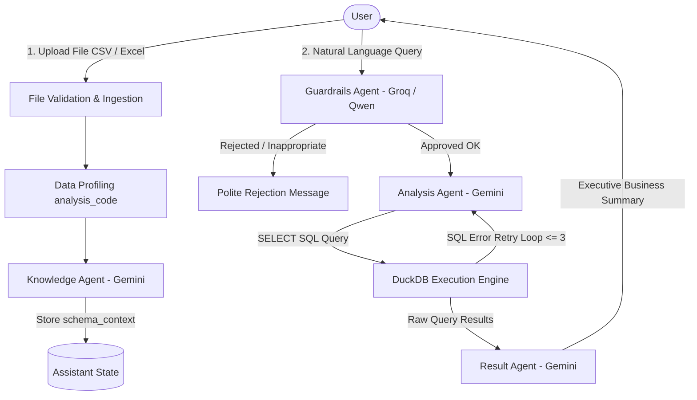

# Data Assistant


An enterprise-grade, conversational multi-agent Business Intelligence (BI) system. Data Assistant empowers users to upload tabular datasets (CSV, Excel) and ask business questions in natural language (supporting both Arabic and English).

The system automatically understands data semantics, generates safe and optimized SQL executed in an isolated in-memory DuckDB sandbox, and translates raw results into clear, executive-level business answers.

---

## Architecture and Agent Workflow

The architecture is orchestrated using LangGraph with a multi-agent pipeline and iterative self-correction:



### Specialized Agents:
1. **Guardrails Agent (`Guardrails_Agent.py`):**
   - Powered by `qwen/qwen3.8-27b` via Groq.
   - Acts as the first line of defense. Classifies user input into:
     - `OK`: Legitimate read-only analytical queries.
     - `WRITE_OPERATION`: Any attempt to mutate data (`INSERT`, `UPDATE`, `DELETE`, `DROP`, `ALTER`).
     - `OFF_SCOPE`: Casual chat, coding questions, general trivia unrelated to the dataset.
     - `INJECTION`: Jailbreak attempts, prompt-leak attacks, or role manipulation.
2. **Knowledge Agent (`Knowlage_Agent.py`):**
   - Powered by `gemini-2.5-flash` via Google GenAI.
   - Executes once upon file upload. Profiles columns, identifies semantic types (`dimension`, `measure`, `time`, `key`), detects data quality issues, and suggests 3 to 5 initial business questions.
3. **Analysis Agent (`Analysis_Agent.py`):**
   - Converts user questions into syntactically strict DuckDB `SELECT` statements based on `schema_context`.
   - Features an autonomous Self-Correction Retry Loop: if DuckDB encounters a syntax or type error, the agent receives the error traceback and refines the query (up to 3 iterations).
4. **Result Agent (`Analysis_Agent.py` -> `result_agent`):**
   - Translates raw numerical rows into clean, non-technical executive findings tailored to the user's language without exposing technical database jargon.

---

## Project Structure

```text
Data-Assistant/
├── src/
│   └── data_assistant/
│       ├── agents/
│       │   ├── Guardrails_Agent.py  # Query classification & safety checks
│       │   ├── Knowlage_Agent.py    # Semantic dataset profiling & question suggestions
│       │   └── Analysis_Agent.py    # SQL generator & Result explainer
│       ├── LLMs/
│       │   ├── ChatGroq.py          # Groq LLM integration
│       │   └── Gemini.py            # Google Gemini LLM integration
│       ├── analysis_code.py         # Multi-encoding file reader & column profiler
│       ├── backend.py               # FastAPI REST API application
│       ├── Data_engine.py           # Hardened DuckDB in-memory execution engine
│       ├── graph.py                 # LangGraph state machine & orchestration
│       ├── main.py                  # CLI runner and server entrypoint
│       ├── state.py                 # AssistantState schema definition
│       └── utils.py                 # File validation & helper utilities
├── evaluations/
│   ├── datasets/                    # Benchmark datasets for Guardrails, SQL, and Knowledge
│   ├── reports/                     # Persisted JSON benchmark reports
│   ├── eval_guardrails.py           # Guardrails Agent classification evaluator
│   ├── eval_knowledge.py            # Knowledge Agent profiling & role evaluator
│   ├── eval_text_to_sql.py          # Text-to-SQL syntax & execution evaluator
│   ├── eval_end_to_end.py           # End-to-End full pipeline scenario evaluator
│   ├── run_evals.py                 # Master evaluation CLI runner
│   └── README.md                    # Evaluations documentation
├── tests/
│   └── test_assistant.py            # Automated test suite
├── .dockerignore                    # Docker build exclusion rules
├── .env.example                     # Environment variables template
├── Dockerfile                       # Container deployment definition
├── pyproject.toml                   # Project configuration & dependencies
└── README.md                        # Documentation
```

---

## Quick Start

### 1. Prerequisites
- Python >= 3.12
- uv (recommended) or pip

### 2. Installation

Clone the repository and install dependencies:

```bash
# Using uv (fastest)
uv sync

# Or using pip
pip install -e .
```

### 3. Environment Configuration

Create a `.env` file from `.env.example`:

```bash
cp .env.example .env
```

Add your API credentials:
```env
# Google Gemini API (Used by Knowledge, Analysis, and Result Agents)
GEMINI_API_KEY=your_gemini_api_key_here

# Groq API (Used by Guardrails Agent for low-latency classification)
GROQ_API_KEY=your_groq_api_key_here

# LangSmith Tracing & Observability (Optional but recommended)
LANGSMITH_TRACING=true
LANGSMITH_API_KEY=your_langsmith_api_key_here
LANGSMITH_PROJECT=data-assistant
```

---

## Usage

### Option A: Run the FastAPI Server
Launch the REST API backend:

```bash
uv run python run.py --server
```
or via module execution:
```bash
uv run python -m data_assistant.main --server
```
or via Uvicorn directly:
```bash
uv run uvicorn data_assistant.backend:app --host 0.0.0.0 --port 8000 --reload
```

- Interactive API Documentation (Swagger UI): `http://localhost:8000/docs`
- Alternative ReDoc UI: `http://localhost:8000/redoc`

### Option B: Interactive Terminal Mode (CLI)
Interact with your data directly in your console:

```bash
uv run python run.py --file "evaluations/datasets/sample_ecommerce.csv"
```
or:
```bash
uv run python -m data_assistant.main --file "path/to/your_dataset.csv"
```

---

## Docker Deployment

You can build and run the application as a Docker container:

### 1. Build the Docker Image
```bash
docker build -t data-assistant .
```

### 2. Run the Container
```bash
docker run -d \
  -p 8000:8000 \
  --env-file .env \
  --name data-assistant-app \
  data-assistant
```

Access the API at `http://localhost:8000/docs`.

---

## REST API Reference

### 1. `POST /api/upload`
Uploads a CSV or Excel file, validates content/size, and generates semantic dataset profiling.
- Request: `multipart/form-data` with `file` (`.csv`, `.xlsx`, or `.xls`).
- Response:
  ```json
  {
    "message": "File uploaded and analyzed successfully.",
    "file_path": "uploads/a1b2c3d4_sales.csv",
    "file_kind": "csv",
    "schema_context": "...",
    "metadata": {
      "tables": [
        {
          "table_name": "data",
          "description": "Sales transactions containing order amounts and regions",
          "example_questions": [
            "What was the total revenue by region?",
            "Who are the top 5 customers by sales volume?"
          ]
        }
      ]
    }
  }
  ```

### 2. `POST /api/chat`
Answers analytical questions about the uploaded dataset.
- Request Body:
  ```json
  {
    "user_query": "What are the top 3 product categories by total sales?",
    "file_path": "uploads/a1b2c3d4_sales.csv"
  }
  ```
- Response:
  ```json
  {
    "final_response": "The top 3 product categories are Electronics ($120,500), Furniture ($85,200), and Apparel ($64,100).",
    "sql": "SELECT \"category\", SUM(\"amount\") AS total FROM \"data\" GROUP BY \"category\" ORDER BY total DESC LIMIT 3",
    "query_result": {
      "columns": ["category", "total"],
      "rows": [["Electronics", 120500], ["Furniture", 85200], ["Apparel", 64100]],
      "truncated": false
    },
    "guardrail_allowed": true,
    "guardrail_category": "OK",
    "error": null,
    "llm_calls": 3
  }
  ```

### 3. `GET /api/health`
Health check endpoint verifying service availability.

---

## Security and Sandboxing

- Complete DuckDB Isolation: External file access and network requests are disabled (`enable_external_access=false`), and database settings are locked (`lock_configuration=true`).
- Strict Read-Only Enforcement: Queries are constrained to `SELECT` statements only; system calls and modification queries are rejected at both agent and database levels.
- Resource Protection: Memory consumption is capped at `1GB` with a strict `10-second` query execution timeout (`con.interrupt`).
- Encoding Resiliency: Handles legacy Arabic Windows encoding (`cp1256`), UTF-8 with BOM (`utf-8-sig`), and Western European (`cp1252`) seamlessly.

---

## Testing and Evaluations

### 1. Automated Unit Tests
Run the test suite verifying file validation, profiling, DuckDB query execution, LangGraph routing, and API endpoints:

```bash
uv run python -m unittest tests/test_assistant.py
```

### 2. Multi-Agent Benchmark Evaluations
Run the comprehensive benchmark evaluation suite measuring Guardrails classification, Knowledge Agent role profiling, Text-to-SQL execution accuracy, and End-to-End workflow success:

```bash
# Run in mock/offline mode (no API keys required)
uv run python evaluations/run_evals.py --mock

# Run against live models and save report
uv run python evaluations/run_evals.py --all --save-report
```

---

## License
This project is licensed under the terms of the LICENSE.txt file.

---

## Author

- **Muhammad Alaasar** - [eng.mo.alaasar@gmail.com](mailto:eng.mo.alaasar@gmail.com)
